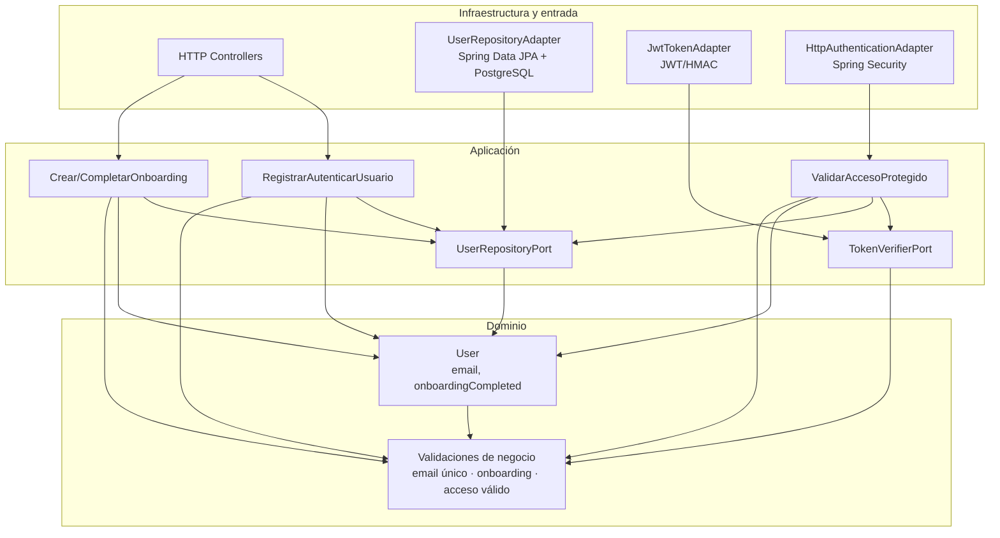

# Reglas de negocio núcleo

## Parte 1

## RN-02: correo electrónico obligatorio, único y de máximo 100 caracteres

El correo electrónico identifica la cuenta del usuario y no puede repetirse dentro del
sistema. Es una regla del negocio porque debe cumplirse independientemente de que el
acceso se realice desde una aplicación web, móvil o API; PostgreSQL y las anotaciones JPA
son solamente mecanismos para hacerla cumplir.

**Entidades involucradas y atributos principales:**

- **User** (`users`), definido en `src/main/java/com/zentia/app/identity/model/User.java`:
  - `id`
  - `email` — obligatorio, único y con longitud máxima de 100
  - `googleId`
  - `name`
  - `pictureUrl`
  - `onboardingCompleted`
  - `phoneNumber`
  - `createdAt`

## RN-04: una cuenta nueva inicia con onboarding incompleto

Una cuenta nueva debe comenzar con `onboardingCompleted = false`. Es una regla del
negocio porque define el estado inicial de la cuenta y, conceptualmente y sirve para conocer mejor al cliente. La interfaz, el controlador
HTTP y la base de datos son detalles de implementación.

**Entidad involucrada:**

- **User** (`users`), con el atributo `onboardingCompleted`.

Por lo tanto, la defensa describe la regla de negocio esperada, mientras que la
implementación actual solo persiste el estado inicial.

## RN-07: las operaciones protegidas requieren autenticación válida

La regla de negocio es que una operación protegida solo puede ejecutarse cuando la
identidad del usuario está autenticada y su acceso sigue vigente. El uso de Google durante
el inicio de sesión, JWT, HMAC y el código HTTP `401 Unauthorized` son decisiones técnicas
para implementar esa regla, no la regla de negocio en sí.

**Entidades y componentes involucrados:**

- **User** (`users`):
  - `id`
  - `email`
  - `googleId`
  - `name`
  - `onboardingCompleted`
- **JWT interno:** no es una entidad persistente; contiene `sub`, `userId`, `name`, `iat`
  y `exp`.
- **SecurityContext de Spring Security:** usa el `userId` extraído del JWT como principal
  durante la petición.

El backend no tiene una entidad `Session` o `Token`. Además, el `idToken` recibido en el
flujo de Google no se verifica contra Google actualmente; el sistema valida el JWT interno
que genera después del login.

## Entidades financieras relacionadas

Estas entidades participan en los casos de uso de transacciones y dashboard:

- **Category** (`categories`): `id`, `name`, `type`, `icon`.
- **Transaction** (`transactions`): `id`, `user`, `category`, `amount`, `type`,
  `description`, `transactionDate`, `createdAt`.
- **TransactionType:** enum con los valores `INGRESO` y `GASTO`.

`Transaction` tiene una relación obligatoria `ManyToOne` con `User` mediante `user_id` y
otra relación obligatoria `ManyToOne` con `Category` mediante `category_id`.

# PARTE 2. Diseño por capas

El diseño sigue una arquitectura hexagonal: las reglas y los casos de uso están en el
interior; los controladores y adaptadores de infraestructura dependen de ellos, nunca al
revés. Los nombres terminados en `Port` representan interfaces que pertenecen a la capa
de aplicación o dominio. Los adaptadores son implementaciones externas de esas
interfaces.

## RN-02: correo obligatorio, único y de máximo 100 caracteres

### Entity

La entidad es `User`. Sus validaciones de dominio son:

- `email` no puede ser nulo ni estar vacío.
- `email` debe tener como máximo 100 caracteres.
- `email` debe ser único en el sistema.

En la implementación actual, las dos primeras condiciones se expresan con
`@Column(nullable = false, length = 100)` y la unicidad con `unique = true` en
`identity/model/User.java`. La entidad debe conservar estas invariantes aunque cambie la
base de datos o la API.

### Use Case: Registrar o autenticar usuario

- **Entrada:** `googleId`, `email`, `name`, `pictureUrl` y, actualmente, `idToken`.
- **Salida:** `AuthResponse` con `userId`, email, nombre, estado de onboarding y JWT.
- **Pasos:**
  1. Validar que el email exista y no supere 100 caracteres.
  2. Buscar una cuenta por `googleId` y, si no existe, por email.
  3. Crear el `User` si no existe o actualizar sus datos permitidos.
  4. Persistir la cuenta garantizando que el email no esté duplicado.
  5. Generar la respuesta de autenticación.

El flujo equivalente existe en `UserService.authenticateWithGoogle`.

### Repository Port

```text
UserRepositoryPort
- findByEmail(email): Optional<User>
- findByGoogleId(googleId): Optional<User>
- save(user): User
```

### Adapter

`UserRepositoryAdapter` implementaría `UserRepositoryPort` delegando en
`UserRepository`, que actualmente extiende `JpaRepository<User, Long>`. La implementación
concreta usaría PostgreSQL mediante Spring Data JPA y la tabla `users`.

## RN-04: una cuenta nueva inicia con onboarding incompleto

### Entity

La entidad es `User`, con la siguiente invariante:

- Toda cuenta nueva debe crearse con `onboardingCompleted = false`.
- Solo un caso de uso autorizado puede cambiar ese valor a `true`.

No existe una entidad `Onboarding` separada en el backend actual. Tampoco existen fechas de
inicio o finalización.

### Use Cases

#### Crear cuenta

- **Entrada:** datos válidos del usuario.
- **Salida:** `User` creado con `onboardingCompleted = false`.
- **Pasos:** validar datos, crear la entidad con el estado inicial, persistirla y devolver
  el resultado.

#### Completar onboarding

- **Entrada:** `userId` y las respuestas del cuestionario.
- **Salida:** `User` actualizado con `onboardingCompleted = true`.
- **Pasos:** buscar el usuario, validar las respuestas, comprobar que el onboarding aún no
  esté completado, cambiar el estado y guardar.

#### Verificar acceso financiero

- **Entrada:** usuario autenticado y operación solicitada.
- **Salida:** autorización de la operación o error de dominio.
- **Pasos:** cargar el usuario, comprobar `onboardingCompleted` y permitir transacciones o
  dashboard únicamente cuando sea `true`.

Estos dos últimos casos de uso son necesarios para cumplir la regla, pero actualmente no
existen como clases: el backend solo crea el usuario con el estado `false`.

### Repository Port

```text
UserRepositoryPort
- findById(userId): Optional<User>
- save(user): User
```

El caso de uso no depende de JPA ni de PostgreSQL; depende de esta interfaz.

### Adapter

`UserRepositoryAdapter` implementaría el puerto usando `UserRepository` y PostgreSQL. El
adaptador solo persiste el estado; la decisión de permitir o bloquear la operación
pertenece al caso de uso.

## RN-07: las operaciones protegidas requieren autenticación válida

### Entity

La entidad de negocio es `User`, porque la identidad autenticada debe corresponder a una
cuenta existente. Sus validaciones son:

- El `userId` extraído del token debe existir.
- El token debe tener una firma válida.
- El token no debe estar expirado.
- La identidad resultante debe asociarse al usuario correcto.

El JWT no es una entidad JPA ni se guarda en una tabla. Es un dato de autenticación
verificado por un servicio externo a la entidad.

### Use Case: Validar acceso

- **Entrada:** token de acceso y operación protegida.
- **Salida:** `AuthenticatedUser`/`userId` autorizado o un error de autenticación.
- **Pasos:**
  1. Recibir el token del adaptador HTTP.
  2. Verificar firma, formato y expiración mediante un puerto de tokens.
  3. Extraer el `userId`.
  4. Consultar el usuario mediante el repositorio.
  5. Autorizar la operación o rechazarla con `401 Unauthorized`.

En el código actual, `JwtAuthenticationFilter` valida firma y expiración, pero no consulta
otra vez a `UserRepository` para confirmar que el usuario siga existiendo. La consulta al
repositorio se incluye aquí como parte del diseño completo de la regla.

### Repository Ports

```text
UserRepositoryPort
- findById(userId): Optional<User>

TokenVerifierPort
- verify(token): AuthenticatedUser
```

`TokenVerifierPort` no es un repositorio de datos: es un puerto de salida para encapsular la
dependencia con el mecanismo de tokens.

### Adapters

- `UserRepositoryAdapter`: implementa `UserRepositoryPort` con Spring Data JPA y
  PostgreSQL.
- `JwtTokenAdapter`: implementa `TokenVerifierPort` con JWT/HMAC. En el código actual, la
  responsabilidad equivalente está repartida entre `JwtUtil` y
  `JwtAuthenticationFilter`.
- `HttpAuthenticationAdapter`: obtiene `Authorization: Bearer ...` y traduce los errores
  del caso de uso a respuestas HTTP. Spring Security cumple actualmente parte de esta
  función.

## Diagrama de capas




La dirección importante es `Infraestructura -> Aplicación -> Dominio`. Ninguna entidad,
regla o caso de uso apunta hacia Spring, PostgreSQL, HTTP o JWT.

# PARTE 5. Cierre

## ¿Qué parte del proyecto costó más ubicar en una capa?

La parte más difícil de ubicar fue la autenticación y el onboarding, porque actualmente
están repartidos entre varias capas. El estado `onboardingCompleted` pertenece al modelo
de dominio (`User`), pero su creación se realiza en `UserService` y todavía no existe un
caso de uso que complete el onboarding o bloquee las operaciones financieras mientras
está incompleto.

La autenticación presenta una dificultad similar: la regla de negocio es validar que el
usuario tenga un acceso válido, pero la generación y validación del JWT están en
`JwtUtil`, la lectura del encabezado HTTP está en `JwtAuthenticationFilter` y las reglas
de acceso están en `SecurityConfig`. Fue necesario separar conceptualmente la regla
(`ValidarAccesoProtegido`) de los detalles de infraestructura (Spring Security, HTTP y
JWT).

## ¿Qué ganan con poder cambiar la infraestructura sin tocar el núcleo?

Ganan independencia, facilidad de mantenimiento y menor riesgo de regresiones. Si los
casos de uso dependen de interfaces como `UserRepositoryPort` y `TokenVerifierPort`, se
puede cambiar PostgreSQL por otra base de datos, Spring Data JPA por otro mecanismo de
persistencia o JWT por otro proveedor de tokens sin modificar las reglas de correo,
onboarding y autorización.

También se pueden probar los casos de uso con adaptadores falsos en memoria, sin levantar
la base de datos ni un servidor HTTP. Esto permite validar el comportamiento del negocio
de forma más rápida y aislada. La infraestructura queda encargada de traducir datos y
protocolos, mientras que el núcleo conserva las decisiones importantes del sistema.
